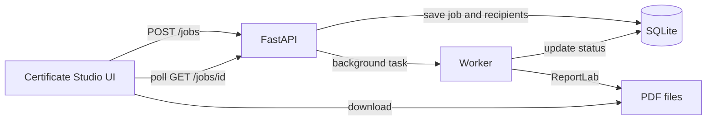

# Certify: Bulk Certificate Generator

[](https://github.com/nadeem015/Certificate-Studio/actions/workflows/tests.yml)


Turn an attendee list into polished PDF certificates in a few clicks. **Certify** is a full-stack web app with a FastAPI backend, a SQLite database, ReportLab PDF generation and a responsive "Certificate Studio" interface.

## Features

- **Bulk generation:** up to 500 recipients per batch, processed in the background.
- **Live preview:** see the certificate update as you type the event and recipient names.
- **Editable recipient table:** add or remove rows, load sample data, with name and email validation and duplicate detection.
- **Live progress:** a progress bar and per-recipient status (success or failed, with the reason).
- **One-click downloads:** each certificate is a landscape A4 PDF with a unique certificate ID.
- **Fault tolerant:** one failed certificate never stops the rest of the batch.
- **Session history:** review recent batches and reopen their results.
- **REST API with docs:** interactive OpenAPI docs at `/docs`.

## Tech stack

| Layer | Technology |
|---|---|
| Backend | Python 3.11, FastAPI, Uvicorn |
| Database | SQLite with SQLAlchemy 2.0 ORM |
| Validation | Pydantic v2, email-validator |
| PDF generation | ReportLab |
| Frontend | HTML, CSS, vanilla JavaScript (no framework) |
| Testing | pytest, FastAPI TestClient, GitHub Actions |

## How it works



1. The UI submits the event name and recipients to `POST /jobs`.
2. The API validates the input, stores the job, and returns `202 Accepted` right away.
3. A background worker creates each PDF and records success or failure for every recipient.
4. The UI polls the job, shows progress, and offers a download link for each finished certificate.

## Getting started

**macOS / Linux**

```bash
python3 -m venv .venv
source .venv/bin/activate
pip install -r requirements.txt
uvicorn app.main:app --reload
```

**Windows (PowerShell)**

```powershell
py -3.11 -m venv .venv
.\.venv\Scripts\Activate.ps1
pip install -r requirements.txt
uvicorn app.main:app --reload
```

Then open **http://127.0.0.1:8000** for the app, or **http://127.0.0.1:8000/docs** for the API docs.

### Configuration

| Variable | Default | Purpose |
|---|---|---|
| `DATABASE_URL` | `sqlite:///./certificate_generator.db` | SQLAlchemy database URL |
| `CERTIFICATE_OUTPUT_DIR` | `certificates` | Folder for generated PDFs |

## API

| Method | Endpoint | Description |
|---|---|---|
| `POST` | `/jobs` | Submit a batch (`event_name`, `recipients[]`) |
| `GET` | `/jobs/{job_id}` | Job progress and per-recipient results |
| `GET` | `/jobs/{job_id}/certificates` | List a job's certificates |
| `GET` | `/certificates/{certificate_id}/download` | Download a PDF |

Example request:

```bash
curl -X POST http://127.0.0.1:8000/jobs \
  -H "Content-Type: application/json" \
  -d '{"event_name": "Tech Symposium 2026",
       "recipients": [{"name": "Ananya Sharma", "email": "ananya@example.com"}]}'
```

## Project structure

```
app/
  main.py          # FastAPI routes and background worker
  certificates.py  # ReportLab PDF layout
  models.py        # SQLAlchemy models (jobs, certificates)
  schemas.py       # Pydantic request/response models
  database.py      # Engine and session setup
static/            # Certificate Studio UI (HTML, CSS, JS)
tests/             # API tests
```

## Running tests

```bash
pytest -q
```

Tests also run automatically on every push through GitHub Actions.

## Roadmap

- Email certificates to recipients automatically
- Import recipients from CSV or Excel
- Customisable certificate templates (logo, colours, signatures)
- Load the full batch history from the database
- A durable job queue (for example Celery or RQ) for larger workloads

## License

[MIT](LICENSE)
